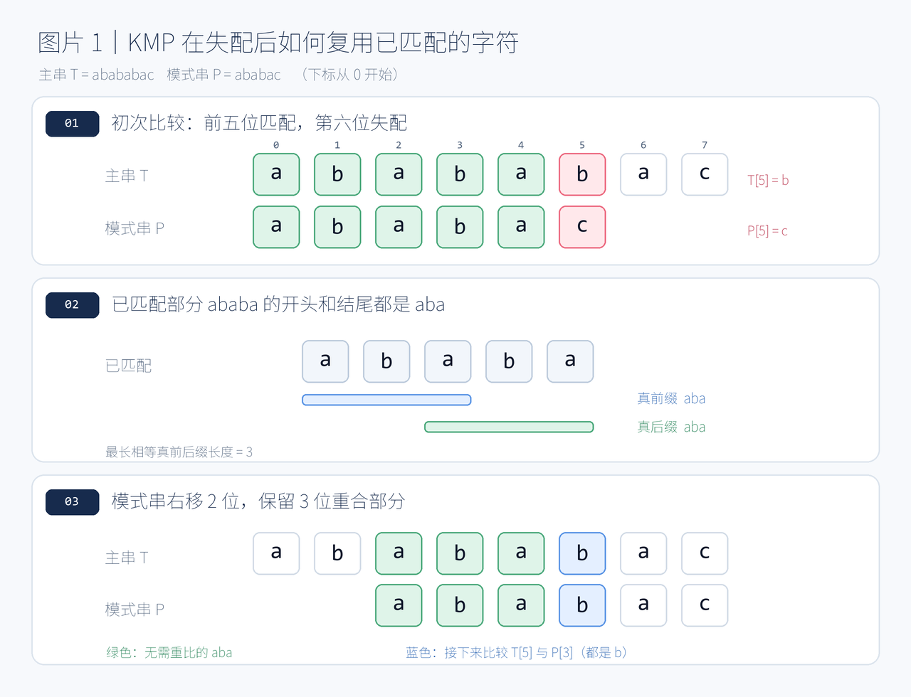

>为什么我打算写这篇文章？
我在去年粗略的学习了一遍基础算法，不过现在忘了。正好今天数据结构课老师提了一嘴。
心血来潮，打算重温一遍这坨。
也当是给我写博客练个手。

>本文主要对象还是入门算法的学生，**至于会kmp的建议立即划走**。

>这是我在我的博客上，打算记录的第一篇文章，或者说也可以是笔记。
我会在这篇笔记完成后，将我之前写过的分类型基础算法题型，整理完上传。

## 什么是KMP算法？

KMP（Knuth–Morris–Pratt）算法是数据结构中经典的字符串模式匹配算法。
主要应对的是：字符串匹配问题，比如：
给定两个字符串：
- 主串（$Text$）：$T = "abababac"$
- 模式串（$Pattern$）：$P = "ababac"$

我们需要找到模式串 P 在主串 T 中第一次出现的位置。

它的核心思想是：当匹配失败时，利用已经匹配过的字符信息，避免重复比较。


## 我们先回顾下，一般我们匹配字符串的方式
**c语言中**，使用
```c
strcmp(a,b)==0;
```

判断$a$、$b$两个字符串是否相等。`strcmp(a, b)` 会逐个比较字符，直到遇到不同字符或字符串结束：两个字符串完全相等时返回$0$；不相等时，根据第一个不同字符的大小关系返回负数或正数，并不保证是$-1$或$1$。因此，`strcmp(a, b) == 0` 这个比较表达式的结果才是$1$（相等）或$0$（不相等）。

**对于普通匹配算法**
最简单的方法是从主串的某个位置开始，逐个比较字符。


普通算法遇到失败，就将模式串向右移动一位，重新比较。
我们发现，如果一匹配失败就直接进行下一个位置的从$0$开始的比较，会浪费许多信息。
像这里，已经成功匹配了$ ababa$，如果直接重新开始，就会重复比较许多字符。

那么，这么充分利用上这段$ababa$，已配对成功的信息呢？
kmp算法可以帮助我们记录这个信息，从而优化配对时间。
朴素匹配算法最坏需要 $O(nm)$ 时间，而 KMP 可以做到$O(n+m)$

## KMP的思想

我们观察原图


它的模式串a b a b a，有一个非常重要的特点：
它的开头是a b a ，而它的结尾也是a b a


所以，如果我们把模式串向右移动两位的话，
```text
T:     a b a b a b a c
P:         a b a b a c
           ✓ ✓ ✓
```
不难发现，由于它的前后缀相同，和朴素比较算法相比，我们可以从第四个字符开始比较，而不是第一个。

因此， KMP 的关键，就是利用已经匹配部分的前缀和后缀相等这一性质，避免重复比较。

不过，这样引出几个问题：
- 为什么一定要找前缀与后缀？
- 如果有多个相等的前后缀，应该选择哪一个？

## 理解KMP算法的具体原理流程
### 回答问题
先给出结论：
我们需要前后缀，是因为，相同的前后缀，才能在移动模式串的部分后，能够做到头尾重合。
对于多个相等的真前后缀，我们关心的是**最长相等真前后缀**。说人话就是，不是自己的，最长的前后缀。

我们不对前后缀定义展开，这里只用例子解释：
令 S = "ababa" 
那么它的前缀包括a，ab，aba，abab，ababa。后缀同理。


在一次匹配失败后，只希望把模式串向右移动。我们发现，如果想要移动到有重合部分的那个位置（第三位），为了保证重叠的部分仍然匹配，模式串的新前缀就必须等于旧匹配部分的某个后缀。
又发现，假如我们不取最长的，非本身的相同前后缀（比如a，a），那么
```text
P:         a b a b a b a c
P’:                a b a b a c
               ?   ✓ 
``` 
从这个思路本身来说，我们可能会漏掉结果。
从朴素算法的角度考虑，第一次，我们匹配了5个符号，第二次，a!=b,匹配失败。我们肯定希望不漏过前面任何可能的结果。
因此，这就解释了为什么 KMP 需要记录「最长相等真前后缀长度」。

### 具体的流程是什么？
前面所提的最长相等真前后缀长度，是KMP调用信息的关键。
我们用前缀函数 $pi$（也经常被称为 LPS 数组），来记录这个信息。

设模式串为：

$$
P=p_0p_1\cdots p_{m-1}
$$


定义：

$$
\boxed{
\pi[i]=
\text{字符串 }P[0\ldots i]\text{ 的最长相等真前后缀长度}
}
$$


注意：
**这里计算的并不是完整模式串的前后缀。**这个我们后面还会提及。
而是对于每一个 i，都取：

$$
P[0\ldots i]
$$

这个从开头到当前位置的子串，再计算它的最长相等真前后缀长度。
例如：
```text
P = "ababac"
```
前缀函数计算表

| i | P[0..i] | 最长相等真前后缀 | pi[i] |
| --- | --- | --- | --- |
| 0 | a | 无 | 0 |
| 1 | ab | 无 | 0 |
| 2 | aba | a | 1 |
| 3 | abab | ab | 2 |
| 4 | ababa | aba | 3 |
| 5 | ababac | 无 | 0 |

最终结果

$$
\boxed{
\text{pi} = [0, 0, 1, 2, 3, 0]
}
$$


这个数组有什么作用？
之前我们的例子，已经成功匹配了五个字符，最后一位失配：
```text
P[0..4] = "ababa"
```
发生失配后，我们想知道最多能够保留多少个已匹配字符。
直接查：
```c
pi[j - 1];
```
也就是：
```c
pi[4] = 3;
```
我们将$j$赋值，也就是把模式串的匹配位置，从$5$（配对失败的位置），改到$3$（下一轮配对的位置）。注意，如果是朴素算法，和$KMP$不同了，第二轮会改到0。
```c
j = pi[j - 1];  // j 从 5 变成 3
```

这样，我们就可以开始一整轮的解释。
### 算法过程
我们先不考虑，pi数组的求解算法，先默认我们已经有这个数组。

我们令，$i$ 是主串目前匹配的位置，$j$为模式串目前匹配的位置。
我们要先知道，i实际上，在整个匹配过程中，是不会回退的。
这里要先和朴素算法区分：朴素算法中，模式串和主串匹配，如果失败了，比如

```text              
T:     a b a b a b a c
                 i
P:     a b a b a c
                 j
       ✓ ✓ ✓ ✓✓ x
```
朴素算法中，i=5会回到i=1，j=5回到j=0。所以朴素算法会有一个参数k来记录这轮本来是从哪个位置开始比较的。
而KMP不同，i不会回退，还会是i=5，或者更大。例如下一步：
```text              
T:     a b a b a b a c
                 i
P:         a b a b a c
                 j 
           ✓ ✓ ✓
```
i仍然是5，变化的只是j的位置，从j=5回到j=3。
所以，当我们有了pi数组，我们可以直接通过公式

$$
\boxed{
j = pi[j-1]
}
$$

让j指针直接指向可以匹配的位置。这样的话，可以继续匹配：
```c
i = 6;
j = 4;
```
>这里有一点：我们如何理解这个pi数组，这个变化，是j减少，还是模式串平移呢？
我认为看成j减少，本质上，j是跳转到前一个能够和前缀重合的一个后缀位置，这个长度是最长后缀的长度，所以是j减少了pi数据的距离。当然，正反都说得通。

这就是KMP算法如何跳转的流程。

最后要说的，就是如何得到这个pi数组了。

### pi数组的求解

回顾定义：

$$
\boxed{\text{pi}[i]=P[0\ldots i]\text{ 的最长相等真前后缀长度}}
$$


这里必须注意：pi[i] 考虑的是 从 P[0] 到 P[i] 这一段字符串，不一定是完整的模式串。
我们用的方法是，利用已经计算出的 pi[0] 到 pi[i-1]，高效地计算 pi[i]。

假设我们已经计算到：
```text
下标:  0 1 2 3 4 5 6
P:     a a b a a a b
pi:    0 1 0 1 2 ? ?
```
现在要计算：pi[5]，即：P[0..5] = "aabaaa"
我们已经知道：
```c
pi[4] = 2;
```
这说明：
```c
P[0..4] = "aabaa"
```
的最长相等真前后缀长度是 2。
也就是
```text
             P[0..4]
下标:       0 1 2 3 4                      0 1 2 3 4 5
字符:       a a b a a           -->        a a b a a a
             └─┘                                     ↑
                   └─┘
             前缀aa = 后缀aa                         新字符
``` 
- 如果 `P[2] == P[5]`，原来长度为 `pi[4] = 2` 的相等真前后缀就能再延长一位，所以 `pi[5] = pi[4] + 1 = 3`。

不过，这里P[2] != P[5]，那怎么办？
虽然长度 3 不行，但可能存在长度 2 或长度 1 的相等真前后缀。
我们尝试，在这串字符的前缀中，找到和这串字符后缀相同的部分，这就像是找模式串和主串，像是自己和自己做KMP算法！     

我们将前缀看成模式串，后缀看成主串。我们的目标，就是在前缀中，找到一个更小的前缀，能够和我的后缀的新后缀匹配。

那，参考KMP的流程，我们可以找这个旧前缀的 **「最长相等真前后缀长度」**。

这样，新前缀的开头，就和旧前缀的新后缀相同，自然，和旧后缀产生的新后缀相同。

具体来说，原本的aabaa，旧前缀是aa（0，1），旧后缀是aa（3，4）。
旧前缀产生的新前缀是a（0），新后缀是a（1）。
旧后缀产生的新前缀是a（3），新后缀是a（4）。
a（0），和a（4），一定是相同的。这个a，不只是具体的a，对于任何相同的结构都成立。
接着，我们只要比较新位置的a（5），是否等于a（1）即可。

如果相同，就得到答案了；如果不同：又回到那个比较b（2）和a（5）的起点，我们的做法还是一样，找新的新前缀的最长相等真前后缀长度。

这个过程就是一个循环，直到最后，没有能匹配的长度，说明，pi[5]=0，得到结果。

整个pi数组的求解就是如此。
               

## 代码

```cpp
#include <bits/stdc++.h>
using namespace std;

vector<int> build_pi(const string& p) {
    int m = (int)p.size();
    vector<int> pi(m, 0);

    for (int i = 1; i < m; ++i) {
        int j = pi[i - 1];
        while (j > 0 && p[i] != p[j]) {
            j = pi[j - 1];
        }
        if (p[i] == p[j]) {
            ++j;
        }
        pi[i] = j;
    }
    return pi;
}

int kmp_find(const string& text, const string& pattern) {
    int n = (int)text.size();
    int m = (int)pattern.size();
    if (m == 0) return 0;

    vector<int> pi = build_pi(pattern);
    int j = 0;
    for (int i = 0; i < n; ++i) {
        while (j > 0 && text[i] != pattern[j]) {
            j = pi[j - 1];
        }
        if (text[i] == pattern[j]) {
            ++j;
        }
        if (j == m) {
            return i - m + 1;
        }
    }
    return -1;
}

int main() {
    ios::sync_with_stdio(0);
    cin.tie(nullptr);

    string text, pattern;
    getline(cin, text);
    getline(cin, pattern);
    cout << kmp_find(text, pattern) << '\n';
    return 0;
}
```
