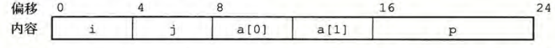
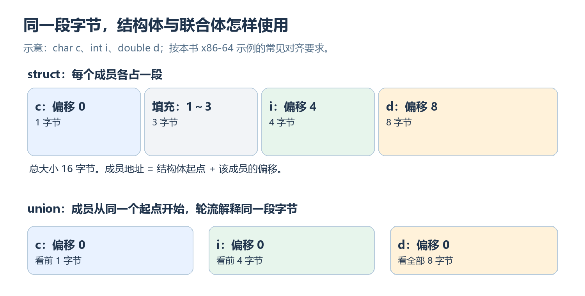
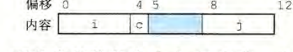

> 对应《深入理解计算机系统》第三版第 3.9.1～3.9.3 节，原书第 183～191 页，所提供 PDF 的第 219～227 页。文中的字节数采用原书的 x86-64 示例；换平台或编译约定时，应重新核对类型大小与对齐要求。


**数组会算地址，结构体也一样**

上一篇的数组元素类型相同，所以访问 `A[i]` 时，只要用下标乘元素大小。结构体里却可能同时有 `char`、`int`、指针。它们大小不同，不能再用同一个步长找成员。

**先记住结论：** 编译器在编译时确定每个成员离结构体起点有多远；程序运行时用 **起始地址 + 成员偏移** 访问它。联合体也用偏移，只是它的成员从同一个位置开始。至于为什么有些偏移之间会空出几个字节，最后再用对齐解释。

---

## 1. 结构体：每个成员有自己的位置

### 一个成员的地址怎么找

先看原书的例子，稍微补上结构体的名字：

```c
struct Rec {
    int i;
    int j;
    int a[2];
    int *p;
};
```

在原书的 x86-64 环境中，`int` 占 $4$ 字节，指针占 $8$ 字节。这个结构体的布局如下图：



从图左边开始读：`i` 在偏移 $0$，`j` 在偏移 $4$，数组 `a` 从偏移 $8$ 开始，`p` 在偏移 $16$，整个 `Rec` 占 $24$ 字节。这里的 **偏移** 不是绝对内存地址，而是离结构体起点的字节距离。若一个 `Rec` 对象从地址 $1000$ 开始，`j` 在 $1004$，`a[1]` 在 $1000+8+4=1012$，`p` 这个成员占据的位置从 $1016$ 开始。

$$
\boxed{\text{成员地址}=\text{结构体起始地址}+\text{该成员偏移}}
$$


### 嵌套数组和指针，别把两层地址混在一起

`a` 是嵌在结构体内部的数组，所以 `r->a[1]` 先走到偏移 $8$ 的数组起点，再走一个 `int` 的 $4$ 字节。`p` 则是一个 **指针成员** ：结构体内部放着 $8$ 字节的地址值，它指向的 `int` 可能在别处。

因此，`r->p` 是取出这个地址；`*(r->p)` 才是去这个地址读取 `int`。别因为图上 `p` 画在结构体的末尾，就以为它指向的数据也紧跟在那里。

成员各有位置，结构体就能同时保存多种信息。但如果几种信息在同一时刻只会用一种，各分配一份空间可能很浪费。这是联合体要解决的情况。

---

## 2. 联合体：成员共用一段空间

### 和结构体放在一起看，区别最直观

```c
struct S {
    char c;
    int i;
    double d;
};

union U {
    char c;
    int i;
    double d;
};
```



看上半部分：`S` 的三个成员各占一段；在这个例子中，`c` 位于偏移 $0$，`i` 位于偏移 $4$，`d` 位于偏移 $8$，整个结构体占 $16$ 字节。中间空出的 $3$ 字节是对齐填充，下一节解释。

再看下半部分：`U` 的三个成员 **起点都是偏移 $0$** 。`c` 使用开头 $1$ 字节，`i` 使用开头 $4$ 字节，`d` 使用整段 $8$ 字节。这不是把三个值同时、各自独立地存进去，而是同一段字节按不同成员类型来使用。因此，这个联合体只需要 $8$ 字节。

原书另一个包含数组成员的例子也体现了同一规律：结构体 `S3` 的成员分别在偏移 $0$、$4$、$16$，总大小 $24$ 字节；联合体 `U3` 的成员都从偏移 $0$ 开始，总大小 $8$ 字节。


可以先用下面两句概括，具体大小仍要考虑对齐：

$$
\boxed{\begin{aligned}
\text{结构体} &: \text{成员依次占空间，必要时留空隙}\\
\text{联合体} &: \text{成员共用起点，大小足以容纳最大成员}
\end{aligned}}
$$

### 共用空间时，程序要知道当前放的是什么

联合体本身不会替我们记录当前使用的是哪个成员。如果一会儿把字节当指针，一会儿又当 `double`，读到的内容就可能没有想要的含义。常见做法是在外面加一个 **标签** ：

```c
enum Kind { NUMBER, LINK };

struct Item {
    enum Kind kind;
    union {
        double number;
        struct Item *next;
    } data;
};
```

当 `kind == NUMBER` 时使用 `data.number`；当 `kind == LINK` 时使用 `data.next`。标签和联合体配合，才让同一段空间的含义清楚。请把 **数值转换** 与 **重用同一段字节** 分开：例如 `(long)3.5` 是得到整数 $3$，联合体成员共享空间并不是在做这种数值转换。


---

## 3. 结构体的数据对齐

### 先看一个只有三个成员的例子

```c
struct S1 {
    int i;
    char c;
    int j;
};
```

若只把成员大小相加，会得到 $4+1+4=9$ 字节。
但原书的布局中，`i` 从偏移 $0$ 开始，`c` 在偏移 $4$**，`j` 没有紧接着放在偏移 $5$，而是放在偏移 $8$**。因为这里的 `int` 要求地址是 $4$ 的倍数，编译器便在 `c` 后留出 $3$ 字节，如下图所示。




**结论： 下一个成员从其本身所占空间的倍数地址位置开始填充。对于$j$，$int$类型的数据占$4$字节，就要从$4$的倍数$（8）$偏移位置开始填充。**

### 为什么结构体末尾有时也要补空隙

再看 `struct S2 { int i; int j; char c; };`。三个成员分别占偏移 $0$～$3$、$4$～$7$ 和 $8$，看起来只用 $9$ 字节。可在原书环境中，`sizeof(struct S2)` 是 $12$：末尾还补了 $3$ 字节。图中蓝色部分就是末尾填充。


**原因要放进数组里看**。如果 `S2 a[2]`，第二个元素紧跟第一个元素；若每个结构体只占 $9$ 字节，`a[1].i` 就会从偏移 $9$ 开始，不能满足 `int` 的 $4$ 字节对齐要求。把单个 `S2` 补到 $12$ 字节，下一项就从 $12$ 开始了。

所以对齐有两处要检查：**成员之间的填充** 让成员地址合适；**结构体末尾的填充** 让连续摆放的下一个结构体也合适。结构体大小不能一律用成员大小直接相加。

