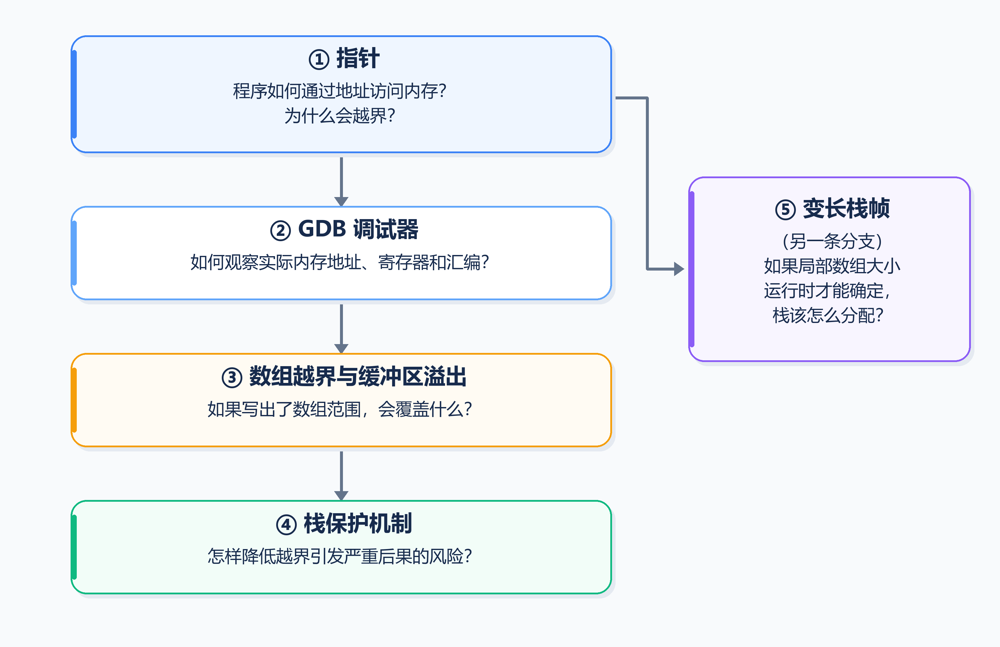
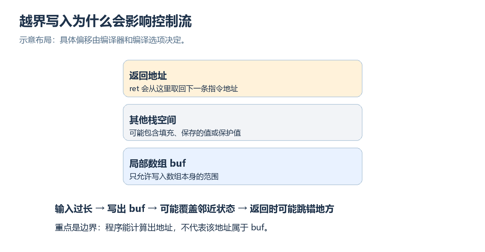
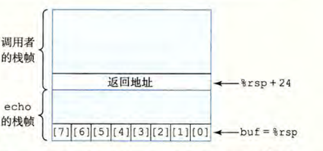
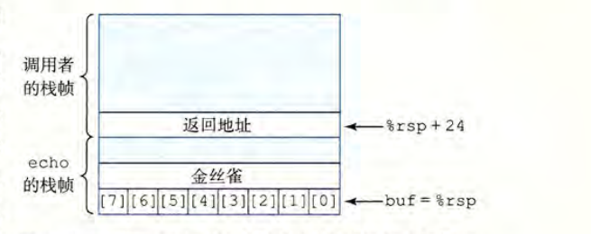
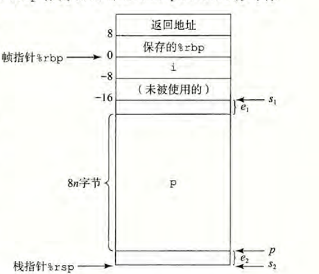

> 对应《深入理解计算机系统》第三版第 3.10.1～3.10.5 节，原书第 192～203 页，所提供 PDF 的第 228～239 页。栈图与汇编布局是原书编译示例，并非所有编译器都会采用相同的偏移。

## 本篇笔记其实包含了好几个不同的知识点：指针、GDB、缓冲区溢出、栈保护机制、变长栈帧。
它们看起来没什么关系，所以如果直接按照笔记从头学到尾，确实容易不知道作者到底想讲什么。
但它们实际上围绕着 CSAPP 第三章的一个核心问题：
- C 语言中的数据是怎么存储在内存里的？
- 为什么对这些数据的读写，甚至可能影响程序的执行流程？
- 为什么数组越界能修改返回地址，以及为什么变长数组需要改变栈帧结构。
  
## 先看整章的知识框架
之前已经学过 call、ret、push、pop、%rsp，也了解函数调用时栈帧的作用。
这一章就是在这些知识基础上，进一步研究内存地址、数据与控制流之间的关系。



---

## 1. 指针保存地址，但不会保存边界

### 类型决定怎么解释这个地址

**结论：** 指针的值是地址；指针的类型决定解引用时读什么、加一时走多远。

CPU 不会理解为“我要访问数组的第二个元素”这样的高级概念。
编译器会根据 p 的类型，生成相应的地址计算和访存指令。
例如：
```c
int a[3] = {10, 20, 30};
int *p = &a[0];

int x = *p;       // x = 10
int y = *(p + 1); // y = 20
```

若 `a[0]` 在地址 $1000$，那么 `p` 保存 $1000$；由于它是 `int *`，`p + 1` 的地址是 $1004$。这里 `*p` 表示到这个地址读取一个 `int`；`&a[0]` 表示取出首元素的地址。指针变量 `p` 自己也占存储空间，它和 `a[0]` 不是同一个对象。

把 `p` 强制转成别的指针类型，并不会把那块内存自动改造成另一种对象；变化的是 **接下来怎样解释这个地址** 。`void *` 可以保存通用对象地址，但在标准 C 里不能直接对它做按元素前进的指针加法，得先确定要按什么类型移动。

### 地址相同，不代表访问一定合法

`p + 3` 可以表示 `a` 末尾后的位置，常用于循环结束判断；它不能被解引用。`p + 4` 已经超出这个数组允许形成的范围。更一般地，一个地址即使看上去像某块内存的地址，也可能已经越界、指向失效对象，或根本没有可访问对象。

这正是指针的局限：`p` 保存地址和类型，却 **不会自动记住 `a` 有 $3$ 个元素** 。读代码时要另找长度、对象生命周期以及指针来源。

### 函数指针指向代码，写法要看括号

指针也能保存函数入口地址。例如：

```c
int twice(int x) { return 2 * x; }
int (*fp)(int) = twice;
int value = fp(5);       // 得到 10
```

`fp` 是指向函数的指针，函数接收一个 `int`、返回一个 `int`。这里的 `(*fp)` 括号不能随意去掉：`int *f(int)` 声明的是 **返回 `int *` 的函数** ，含义完全不同。函数指针让程序通过保存在数据里的地址选择要调用的代码；后面分析返回地址时，也会看到地址怎样决定控制流。


---

## 2. 那 GDB 在这章中到底起什么作用？

**结论：GDB 的作用是把正在运行的程序暂停，让我们看到当前指令、寄存器和内存。** 
GDB 不是新的一种内存机制，而是一个帮助你观察上面这些行为的调试工具。
因为你学 CSAPP 时，书里会不断提到地址、寄存器、栈和汇编，但这些东西用普通的 C 语言输出不一定容易看明白。
GDB 就是让你在程序运行过程中暂停，并观察它们。

一个够用的入门流程是：

| 要做什么 | 常用命令 | 看到了什么 |
| --- | --- | --- |
| 在函数入口停下 | `break foo`，然后 `run` | 程序执行到 `foo` 时暂停 |
| 看这个函数的机器指令 | `disassemble foo` | C 语句被编译成了哪些指令 |
| 一次走一条机器指令 | `stepi` 或 `nexti` | 寄存器、栈怎样变化；`nexti` 通常跨过函数调用 |
| 看寄存器 | `info registers` | 例如当前 `%rsp` 的值 |
| 看栈上的字节 | `x/16xb $rsp` | 从栈顶地址起，显示 $16$ 个十六进制字节 |

比如在函数调用前后看 `%rsp`，能对应上一节学过的压入返回地址；查看某个局部数组附近的内存，能看到它旁边还有其他栈内容。**调试器展示的是一次具体运行** ，编译选项、输入和运行环境不同，地址与布局可能变化。

知道怎样观察之后，再看原书为什么特别关注局部数组附近的内存：这里可能不只有数组的数据。

---
**前面说到**
C 语言规定了合法的访问范围，但编译出来的普通访存指令通常不会自动替你做数组边界检查。
于是便产生了下一部分的核心问题：**如果访问了不属于自己的内存，会发生什么？**
## 3. 为什么数组越界可能修改函数的返回地址
先回忆前面学过的函数调用。
### 函数调用时，栈里有什么？

考虑这个程序：

```c
void foo() {
    int x = 10;
    char buf[8];
}

int main() {
    foo();
    return 0;
}
```
当 main 调用 foo 时：
```asm
call foo
```

call 主要做两件事：
1. 将返回地址压入栈中，即 `foo`执行结束后应该回到的位置。
2. 跳转到 `foo` 开始执行。

那么 `foo` 的局部变量放在哪里？
在通常的、未被优化掉的栈帧实现中，局部变量也可能放在栈上。
于是：返回地址和局部数组，可能就在同一块连续的栈内存中。


`buf` 有 $8$ 字节。如果输入按 C 字符串存放，还要为末尾的 `\0` 留 $1$ 字节，所以最多只能装 $7$ 个普通字符。输入更长时，写入不会自动停在 `buf[7]`：后续字节可能覆盖相邻的栈空间。这就是 **缓冲区溢出**，覆盖上面的栈内容。



沿图从下往上看：先是局部数组 `buf`，再是它附近的其他栈空间，某些布局里还会碰到返回地址。`ret` 会从栈上取回返回地址；**如果这个地址被覆盖，程序可能跳到错误位置，而不是回到调用者原本的下一条指令。**

原书图 3-40 是一个 **具体编译结果** ：`buf` 位于返回地址下方，二者之间还隔着一些栈空间。



当返回地址遭到破坏后，结果就可能是程序崩溃，或者在某些条件下执行到非预期的代码位置。
这就是为什么缓冲区溢出不仅是一个普通的数据错误，还可能造成控制流破坏。
既然越界这么危险，计算机怎么防止？
因此，第四节将谈到三种保护措施。

---

## 4. 三层保护

### 1.栈保护值（Stack Canary）



与上一张原书图相比，这里在 `buf` 和返回地址之间多了一段 **栈保护值** ，也常叫**金丝雀值**。函数进入时保存一个值，返回前检查它有没有变化；若发现异常，就终止正常执行。

它只能检测 **会触及栈保护值的写入** 。没有碰到封条的越界，或者发生在其他位置的错误，并不会因此自动消失。

### 2.ASLR：地址空间布局随机化

地址空间布局随机化常简称 **ASLR** 。它让栈、库等区域在不同运行中出现在不同地址。于是，事先假定某个返回地址总能跳到同一位置，就不再可靠。ASLR 改变的是 **地址是否容易预测** ，不是数组的边界。

### 不可执行页（NX）

系统可以把栈等数据区域标记为 **不可执行** 。即使有人把机器指令字节写进栈，处理器也不应直接从这样的页面执行它们。这限制了某类攻击方式，但并没有让越界写入变合法。

三者可以连起来记：**栈保护值检查关键状态是否被改坏；ASLR 增加地址预测难度；不可执行页限制从数据区运行代码。** 它们都不能代替程序自身的边界检查。

到这里，栈在图里看起来像一块大小固定的区域。但有些局部数组的长度来自参数，函数运行之前不知道要留多少空间。原书最后用这种情况回到栈帧的实现。

---

## 5. 变长栈帧

### 先分清形参和真正创建的数组

在 3.8 节里，函数形参 `int A[n][n]` 最终接收的是已有数组的地址，不会因为这个形参重新创建 $n\times n$ 个元素。下面这种 **函数体内的声明** 则不同：

```c
void work(long n) {
    long *p[n];  // n 个指针组成的局部数组；假设 n > 0
    /* 后面要使用 p */
}
```

这是 C 的变长数组语法，标准 C++ 不支持。**`n` 到调用时才有值，故编译器不能像固定大小的局部变量那样，事先为 `p` 写死一个字节数。** 在原书的 x86-64 环境里，每个指针占 $8$ 字节，数组本身至少需要 $8n$ 字节；实际调整栈指针时还可能多留一些空间，以满足对齐要求。


### 为什么这时可能需要帧指针

上一节讲栈帧时，常用 `%rsp` 表示栈顶。但如果数组大小由 `n` 决定，函数运行中 `%rsp` 可能要减去一个运行时才算出来的量。此时，若还想用固定偏移找到另一个局部变量，就需要一个更稳定的参照位置。

我们用 `%rbp` 充当 **帧指针** ：先把当前栈帧的一个固定位置记在 `%rbp`，再按 `n` 调整 `%rsp`。

>先搞清楚 rsp 和 rbp 是什么
它们都是 x86-64 的寄存器，里面保存的都是内存地址。
>- %rsp：栈指针（Stack Pointer），指向当前栈顶。
>- %rbp：基址指针（Base Pointer），通常可以用来保存当前函数栈帧的一个固定参考地址。
这里有个很重要的区别：
%rsp 会随着栈空间的分配和释放而变化；如果编译器使用 %rbp 作为帧指针，那么 %rbp 在这个函数执行期间通常保持不变。

图中 `i` 在 `%rbp` 附近的固定偏移位置，而变长数组 `p` 随 `n` 改变大小。



从图上看，`%rbp` 是固定的参考点，`%rsp` 指向当前栈顶；数组变大时，栈顶位置会变。函数结束时恢复栈指针，便能一次释放这段局部空间。

局部变长数组还要注意两件事：长度应为有效的正值；如果申请的空间太大，栈也可能容纳不下。编译器可能优化掉没有实际用途的数组，所以上面的短代码只用来说明 **对象大小在运行时决定** ，不要据此推断某次编译一定会出现栈分配指令。

---

## 这一篇的主线

七、最后把整章重新串起来
现在你可以这样理解 CSAPP 3.10：

指针：地址是程序访问内存的重要依据。指针提供地址和类型，但不会自动保证访问有效。

GDB：让我们从 C 代码进入真实的机器执行过程，观察寄存器和内存。

缓冲区溢出：数据越界可能破坏栈中的其他内容，甚至破坏返回地址，从而影响程序执行位置。

安全保护：Canary、ASLR、NX 分别从检测破坏、随机化地址、限制执行权限等方面降低风险。

变长栈帧：当局部数组的大小只能在运行时确定，栈空间就需要动态分配；帧指针可以提供稳定的寻址基准。

下一篇进入浮点代码。我们仍会用同样的办法读机器程序：先确定数据放在哪里，再看指令怎样移动、计算和比较它。
